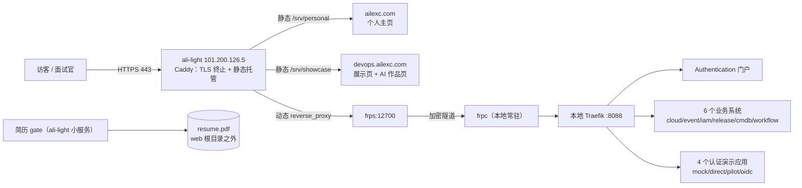

# 个人作品集公网发布与 GitHub 开源 · 实施计划（2026 Q4）

> 版本：v1.1 ｜ 日期：2026-10-29 ｜ 状态：执行中（批次 A）
> 本文件是后续执行的唯一清单。每完成一项勾选，不另起文档。
> v1.1 变更：新增 §0 决策 11–14；修正 §2.1 过时的 DNS 待办；用实测快照替换 §8 进度快照；新增批次 A（收口）与批次 C（GitHub 收尾）任务表。

---

## 0. 决策摘要（已确认）

| # | 事项 | 结论 |
|---|---|---|
| 1 | DevOps 全家桶 | **完全公开**，不加门禁；允许写操作，靠定时重置兜底 |
| 2 | 三个 AI 项目 | **不公网运行**；各做一个静态产品讲述页 + GitHub 链接 |
| 3 | 个人主页 | `ailexc.com` / `www.ailexc.com` 公开访问；简洁明亮；中英双语 |
| 4 | 简历下载 | **L1 档**：手机尾号 4 位 + 限流；不做邮箱验证、不做专属码 |
| 5 | HTTPS 证书 | **逐域名签发**，不引入通配符（Caddy 原生能力，零维护） |
| 6 | GitHub 账号 | `Ailexc`（账号已注册，仓库待建） |
| 7 | 主页姓名 | 只显示英文名 `ailexc`；不上真人照片，用生成的程序员形象图标 |
| 8 | 绩效评级 | **不写入主页**（只保留"技术进步奖"） |
| 9 | 岗位定位 | **AI Agent 工程（转岗中，主）** · DevOps / 平台开发 · 全栈开发 |
| 10 | 内网工作文档 | `docs-local/` 不进公开仓库（含飞书内链与面试笔记） |
| 11 | 主域策略（2026-10-29 追加） | **`ailexc.com` 直接服务**（`/srv/personal`），`www.ailexc.com` **301 → 主域** |
| 12 | GitHub 远端（2026-10-29 追加） | **`origin` 改 GitHub（主）**，`gitee` 保留为镜像远端 |
| 13 | 三个 AI 项目口径（2026-10-29 追加） | 维持原计划：**只做静态作品页，不公网运行**；`aianytra.ailexc.com` 保留 Authelia 自用入口 |
| 14 | 稳定性批次（2026-10-29 追加） | **批次 B（S6）暂缓**，优先完成收口与 GitHub 发布 |
| 15 | 公开仓库入口（2026-10-29 追加） | **Gitee 为主**（国内可直连），GitHub 保留为备用与代码备份 |

---

## 1. 目标与范围

### 1.1 三个目标

1. **DevOps 全家桶公网可演示**：`devops.ailexc.com` 展示页 + 七个系统在线可交互
2. **个人主页上线**：`ailexc.com`，作为简历/投递的统一入口
3. **四个仓库开源到 GitHub**：代码可被查看、可被 clone 跑通

### 1.2 明确不做（防止范围蔓延）

- ❌ AiAnyTra / AiCumi / AiCodeReviewTeam 公网在线运行（含"免费模型"方案）
- ❌ 通配符证书、自建 Caddy 镜像
- ❌ Authelia 门禁（DevOps 全公开）
- ❌ 简历 L2 专属码 / L3 邮箱验证
- ❌ 主页挂真实照片、绩效评级
- ❌ 把 `docs-local/`、飞书内链、面试叙事公开

---

## 2. 目标架构



要点：

- 阿里云只负责 **TLS + 静态 + 一条隧道**；新增系统只改本地 Traefik 路由
- 业务流量全部经 FRP 回源本地，阿里云不承载业务容器（2C2G 也扛不住）
- 静态站点直接由 Caddy 托管，不占隧道带宽

### 2.1 域名矩阵

| 域名 | 内容 | 访问 | 来源 |
|---|---|---|---|
| `ailexc.com` | 个人主页 | 公开 | Caddy 静态 `/srv/personal` |
| `www.ailexc.com` | 同上（301 → 主域） | 公开 | 同上 |
| `devops.ailexc.com` | 全家桶展示页 + AI 作品页（`/ai/*`） | 公开 | Caddy 静态 `/srv/showcase` |
| `portal.devops.ailexc.com` | 统一门户 Authentication | 公开 | Traefik → portal |
| `cloud.devops.ailexc.com` | CloudManager | 公开 | Traefik → cloud |
| `event.devops.ailexc.com` | EventManager | 公开 | Traefik → event |
| `iam.devops.ailexc.com` | PermissionCenter | 公开 | Traefik → iam |
| `release.devops.ailexc.com` | ReleaseManager | 公开 | Traefik → release |
| `cmdb.devops.ailexc.com` | TaskManager | 公开 | Traefik → cmdb |
| `workflow.devops.ailexc.com` | WorkFlowCenter | 公开 | Traefik → workflow |
| `mock / direct / pilot / oidc .devops.ailexc.com` | 认证演示应用（可选） | 公开 | Traefik → 对应服务 |
| `viz.devops.ailexc.com` | 架构图静态资源（已有） | 公开 | Caddy 静态 `/srv/visuals` |
| `aianytra.ailexc.com` | 仅自己使用（不进主页、不对外宣传） | 🔒 Authelia | 现有 FRP 隧道保留 |

> ✅ DNS 实测（2026-10-29 复核）：`ailexc.com`、`www.ailexc.com` 及 10 个 `*.devops` / `aianytra` 域名**均已解析到 `101.200.126.5`**，原"缺少 A 记录"的待办已失效。
> ⚠️ 真实缺口是**云端 Caddyfile 里没有 `ailexc.com` 站点块**：`curl https://ailexc.com` 返回 TLS internal error（HTTP 000），只有 `www` 可达 → 见批次 A1/A2。

### 2.2 执行原则：本地先行，云端最小变更

**不在云上直接改配置**（紧急排障除外）。所有变更走「本地改 → 本地验 → 备份 → 上云 → 验证 → 可回滚」。

| 层 | 存在哪 | 怎么改 | 怎么验 | 怎么回滚 |
|---|---|---|---|---|
| 业务代码 / 路由模板 / env | 本地 git 仓库 | 工作分支 + commit | 本地 `curl -H "Host: xxx"` 打 Traefik `:8088` | `git revert` + 重新部署 |
| Caddyfile（云端） | 目前只在云上，**本次纳入 homelab 版本管理** | 本地改 → `caddy validate` → scp | `curl -I` 各域名 | 恢复 `Caddyfile.bak-*` + `caddy reload` |
| frpc.toml（本地） | `~/frpc/frpc.toml`，**纳入 homelab** | 本地改 → 重启容器 | 日志出现 `start proxy success` + 隧道端口可访问 | 恢复备份 + 重启 |
| 静态站（主页 / 展示页） | 本地构建产物 | 本地起服务预览 → rsync | 云端 `curl` + 手机 4G | 云端保留上一版目录 |
| 容器编排 | 各项目 compose | 本地 commit → 云端 `git pull` / rsync | `docker compose ps` + 冒烟 | `docker compose down` + 上一版镜像 |

**一次只动一个变量**：先打通 portal 单域，通过后再复制到其余域名；Cookie 域、CORS、路由三者分三批验证。

**云端变更前置动作**（每次必做）：

```bash
# 1. 备份（时间戳）
cp Caddyfile Caddyfile.bak-$(date +%Y%m%d-%H%M%S)
# 2. 语法校验（不生效）
docker exec caddy caddy validate --config /etc/caddy/Caddyfile --adapter caddyfile
# 3. 热加载
docker exec caddy caddy reload --config /etc/caddy/Caddyfile
# 4. 验证失败 → 恢复备份 + 再 reload
```

**变更台账**：每批变更在 §8 追加一行（时间 / 改了什么 / 验证结果 / 是否回滚）。

---

## 3. 实施阶段

### S0 · 准备（0.5 天，需要你参与）

| # | 任务 | 负责 | 状态 |
|---|---|---|---|
| 0.1 | 阿里云 DNS 添加 `ailexc.com`、`www` A 记录 | 你 | ☐ |
| 0.2 | 微信二维码图片放到 `PublicSite/public/assets/wechat-qr.png` | 你 | ☐ |
| 0.3 | 简历 PDF 初稿放到 `PersonalSite/private/resume.pdf`（未写好可后补） | 你 | ☐ |
| 0.4 | 确认 GitHub 仓库命名与可见性 | 你 | ☐ |
| 0.5 | 确认 LICENSE（建议 MIT） | 你 | ☐ |
| 0.6 | 生成 GitHub 专用 SSH 密钥并注册到账号 | 我 + 你 | 密钥已生成，**待你粘贴到 GitHub** |
| 0.7 | 在 GitHub 创建 5 个空仓库（不用初始化 README） | 你 | ☐ |
| 0.8 | 把 ali-light 的 `Caddyfile`、本地 `frpc.toml` 纳入 `homelab` 版本管理 | 我 | ☑（2026-10-29） |
| 0.9 | 备份 ali-light 现有 Caddy / frp 配置 | 我 | ☑（2026-10-29） |

**验收**：`dig ailexc.com` 能解析到 `101.200.126.5`；`ssh -T git@github.com` 返回 `Hi Ailexc!`。

---

### S1 · 打通公网链路（0.5 天）

**目标**：先用一个域名验证「Caddy → FRP → Traefik → 容器」全链路，再批量铺开。

| # | 任务 | 状态 |
|---|---|---|
| 1.1 | `frpc.toml` 新增 `devops-gateway`：`localPort=8088 → remotePort=12700` | ☑（2026-10-29） |
| 1.2 | 重启 frpc 容器，确认隧道注册成功 | ☑（`start proxy success`） |
| 1.3 | 阿里云 Caddy 增加 `portal.devops.ailexc.com` 站点 → `reverse_proxy frps:12700` | ☑（2026-10-29） |
| 1.4 | 验证 Let's Encrypt 证书签发成功（HTTP-01） | ☑（有效期至 2027-01-27） |
| 1.5 | Traefik 路由模板加 `portal.devops.ailexc.com` Host 规则并 reload | ☑（`PUBLIC_DOMAIN` 变量化） |
| 1.6 | 外网访问门户登录页，完成一次登录 | ☑（200 + 页面标题正确，HTTP→HTTPS 308） |

**验收**：手机 4G（非内网）打开 `https://portal.devops.ailexc.com` 能登录。

**风险**：阿里云安全组未放行 80 → 先 `curl -I http://portal.devops.ailexc.com` 排查。

---

### S2 · 全家桶七系统公网化（2 天）

| # | 任务 | 说明 | 状态 |
|---|---|---|---|
| 2.1 | Traefik 路由模板加 7 个公网 Host 规则 + `generate-routes.sh` 变量化 | 一次性改模板 | ☑ 2026-10-29 |
| 2.2 | **跨子域会话**：`_gw_session` Cookie 增加 `Domain=.devops.ailexc.com`（env 可配） | 核心改造点 | ☑ 已验证 Set-Cookie |
| 2.3 | `deploy/server/.env.server`：`PORTAL_URL`、`APP_URL_*` 全部改 `https://` | 门户跳转正确 | ☑ |
| 2.4 | Django 侧：`ALLOWED_HOSTS`、`CSRF_TRUSTED_ORIGINS`、`CORS_ALLOWED_ORIGINS` 补 https 域名 | 6 个 Django 项目 | ☑（ALLOWED_HOSTS 通配 + 反代头） |
| 2.5 | 反代头：`SECURE_PROXY_SSL_HEADER`、`USE_X_FORWARDED_HOST` | 避免 http 回跳 | ☑ 5 个 Django 项目 |
| 2.6 | ReleaseManager OIDC `redirect_uris` 改 `https://release.devops.ailexc.com/oauth/callback` | OIDC 登录 | ☑（seed 已同步） |
| 2.7 | OIDC Demo 回调地址同步 | 演示应用 | ☑ |
| 2.8 | 演示应用（mock/direct/pilot/oidc）公网路由（可选） | 认证故事完整 | ☑ |
| 2.9 | 关闭外部可见的调试入口（Traefik Dashboard、Django DEBUG） | 安全 | ☐（待办） |
| 2.10 | 展示页 `CONFIG.portalUrl` 改 `https://portal.devops.ailexc.com`；`githubRepo` 填 `https://github.com/Ailexc/devops-platform` | 首页 | ☑ |
| 2.11 | 展示页每个系统卡片加「在线体验」按钮 | 转化路径 | ☑ |
| 2.12 | 全部域名跑一遍登录 → 业务操作 → 登出 | 冒烟 | ☑（curl 全链路 + Cookie 验证） |

**验收**：从门户依次跳转 7 个系统，**无需重复登录**；每个系统能查到数据、能完成一次写操作。

**已知风险**：
- Cookie 域改错会导致全部系统掉登录 → 先在 `portal` 单域验证
- Django `CSRF_TRUSTED_ORIGINS` 漏配 → 写操作 403
- 用 HTTPS 后前端硬编码 `http://` 地址会触发混合内容拦截 → 需全局 grep 复核

---

### S3 · 三个 AI 静态作品页（1 天）

统一结构（每页一屏半左右）：

```
Hero：一句话定位 + 项目角色 + 时间 + [GitHub]
01 问题：要解决什么（真实场景）
02 架构：一张架构图（复用 visuals/ 已产出的 archify 图）
03 技术亮点：3 条，带取舍
04 截图 / 录屏：2–4 张关键界面
05 复盘：踩过的坑与边界
```

| # | 任务 | 状态 |
|---|---|---|
| 3.1 | 目录结构 `docs/showcase/ai/{anytra,review,cumi}/index.html` | ☐ |
| 3.2 | AiAnyTra 页（强调：多源解析 → 模型路由 → 飞书文档落地） | ☐ |
| 3.3 | AiCodeReviewTeam 页（强调：CrewAI 双层编排 + 真实静态分析工具链） | ☐ |
| 3.4 | AiCumi 页（强调：AG2 多 Agent + WS 流式 + 向量记忆） | ☐ |
| 3.5 | 复用 `visuals/` 下已有架构图（不重画） | ☐ |
| 3.6 | 截取关键界面图，压缩到 WebP（单图 < 200KB） | ☐ |
| 3.7 | 展示页加入口卡片，链接到三个作品页 | ☐ |
| 3.8 | `aianytra.ailexc.com` 保持 Authelia 保护、仅自用；主页不放该入口（若确认不再使用，再下线站点与隧道） | ☐ |

**验收**：三个页面在手机上可读，图片懒加载，无横向滚动。

---

### S4 · 个人主页（2 天）

| # | 任务 | 状态 |
|---|---|---|
| 4.1 | 初始化 `PersonalSite`（Astro 或纯静态，内容用 JSON/Markdown 驱动） | ☐ |
| 4.2 | 中英双语切换（默认中文，`/en` 路由或 i18n 切换） | ☐ |
| 4.3 | 首屏 / 关于 / 能力 / 项目 / 经历 / 技术栈 / 教育 / 联系 八区块 | ☐ |
| 4.4 | 生成扁平风程序员形象头像（SVG，不涉及真人照片） | ☐ |
| 4.5 | 深/浅色跟随系统 + 手动切换 | ☐ |
| 4.6 | 响应式（375 / 768 / 1440 三档实测） | ☐ |
| 4.7 | SEO：`title` / `description` / `og:image` / `robots.txt` / `sitemap` | ☐ |
| 4.8 | 性能：无外部字体阻塞、图片 WebP、Lighthouse ≥ 90 | ☐ |
| 4.9 | 简历 gate（见 §4） | ☐ |
| 4.10 | 部署到阿里云 `/srv/personal`，Caddy 配 `ailexc.com` + `www` | ☐ |
| 4.11 | 微信二维码「点击展开」 | ☐ |

**验收**：`https://ailexc.com` 打开 < 2s；切换英文无残留中文；简历未验证时无法下载。

---

### S5 · GitHub 开源发布（1.5 天）

#### 5.1 仓库规划

| 本地目录 | GitHub 仓库 | 可见性 | LICENSE |
|---|---|---|---|
| `DevOpsPlatform` | `Ailexc/devops-platform` | Public | MIT |
| `VibeCoding/AiAnyTra` | `Ailexc/ai-anytra` | Public | MIT |
| `VibeCoding/AiCodeReviewTeam` | `Ailexc/ai-code-review-team` | Public | MIT |
| `VibeCoding/AiCumi` | `Ailexc/ai-cumi` | Public | MIT |
| `VibeCoding/PersonalSite` | `Ailexc/personal-site` | Public（可选） | MIT |

远端策略：`origin` = GitHub（主），`gitee` = 现有 Gitee（备份镜像）。**待你确认**是否保留 Gitee。

#### 5.2 历史清理（关键）

已实测：四个仓库的 git 历史中**没有真实密钥**（只有 demo 占位值），但：

- `docs-local/` 在历史中：29 / 18 / 23 / 19 个文件（含飞书内链、面试叙事）
- `DevOpsPlatform` 历史含 16 个 `.env`（均为演示占位）

**处理方式**：不做原地改写，采用「镜像仓 + `git filter-repo`」：

```bash
# 在副本上操作，不动原仓
cp -a <repo> /tmp/<repo>-public
cd /tmp/<repo>-public
git filter-repo --path docs-local --invert-paths
```

推 GitHub 用清理后的副本，Gitee 保持原样。

#### 5.3 每仓发布清单

| # | 任务 | 状态 |
|---|---|---|
| 5.3.1 | 敏感复扫（`docs/open-source-checklist.md` 两条 grep） | ☐ |
| 5.3.2 | `docs-local/` 出仓 + `.gitignore` | ☐ |
| 5.3.3 | 历史清理（filter-repo，副本操作） | ☐ |
| 5.3.4 | README 首屏：一句话定位 + 截图 + 技术栈 + 快速开始 | ☐ |
| 5.3.5 | LICENSE（MIT）+ 版权年份 | ☐ |
| 5.3.6 | `.env.example` 补全注释；确认无真实凭据 | ☐ |
| 5.3.7 | 分支收敛：`docs/*` 工作分支合回 `main` | ☐ |
| 5.3.8 | 干净机器彩排：`git clone` → 按 README 启动 | ☐ |
| 5.3.9 | 建仓 + push + 打 tag（`v1.0.0`） | ☐ |
| 5.3.10 | 仓库 About / Topics / 首页链接回填个人主页 | ☐ |

**验收**：陌生环境 clone → `docker compose up` 能起；GitHub 打开 README 有图有命令。

---

### S6 · 稳定性与验收（0.5 天）

| # | 任务 | 状态 |
|---|---|---|
| 6.1 | 所有容器 `restart: unless-stopped` | ☐ |
| 6.2 | Docker 日志轮转（`/etc/docker/daemon.json`） | ☐ |
| 6.3 | 演示数据每日 04:00 重置（宿主机 cron + `make reset`） | ☐ |
| 6.4 | 健康检查：7 系统 + 门户 + 主页，每 5 分钟 | ☐ |
| 6.5 | 异常通知到飞书（webhook） | ☐ |
| 6.6 | 数据备份：PG 卷 + 各项目 SQLite，每日打包保留 7 天 | ☐ |
| 6.7 | 重启演练：本机 reboot → 全站自动恢复 | ☐ |
| 6.8 | 最终验收（§6） | ☐ |

---

## 4. 简历下载 L1 设计

### 4.1 交互

```
https://ailexc.com/resume
  ├─ 输入：手机号后 4 位
  ├─ 失败：提示"验证码不正确"，5 次后锁定 15 分钟（按 IP）
  └─ 成功：种 HttpOnly Cookie（HMAC 签名，30 分钟）→ 下载 PDF
```

### 4.2 实现

| 组件 | 说明 |
|---|---|
| 服务 | `resume-gate`（FastAPI 或 Go，约 100 行），跑在 ali-light Docker 网络内 |
| 存储 | PDF 放 `/home/admin/resume/resume.pdf`（**web 根目录之外**） |
| 校验 | 4 位码只存哈希；常数时间比较 |
| 限流 | 5 次 / 15 分钟 / IP；失败递增延迟 |
| 审计 | 记录时间 / IP / UA，每日汇总推送飞书 |
| 路由 | Caddy：`/resume` → gate；`/resume.pdf` 直连一律 404 |

### 4.3 边界说明

- 这层门的作用是**防爬虫、防随意浏览、防批量收集**，不防"已拿到 PDF 的人转发"
- 4 位码理论可穷举，靠限流兜底；如后续需要更强，再升级到 L2 专属码

---

## 5. 风险与对策

| 风险 | 影响 | 对策 |
|---|---|---|
| 跨子域 Cookie 配错 | 全站掉登录 | 先单域验证，再批量；保留回滚开关 |
| Django CSRF/ALLOWED_HOSTS 漏配 | 写操作 403 | 7 系统逐个冒烟，脚本化检查 |
| 公网可写被恶意破坏 | 数据脏 | 每日重置 + 备份 + 限流 |
| 家庭网络/断电 | 全站不可用 | 重启自恢复 + 监控告警 + 提前告知 |
| 阿里云流量计费 | 费用超预期 | 上线后观察 3 天流量；静态资源走 CDN 可选 |
| 历史泄露 docs-local | 隐私 | filter-repo 清理后推送 |
| Let's Encrypt 签发失败 | HTTPS 不可用 | 逐域验证；失败回退 DNS-01 方案 |
| 主页简历被爬 | 隐私 | L1 gate + robots.txt + `noindex` |

---

## 6. 总验收清单

- [ ] `https://ailexc.com` 正常，中英切换正常，移动端无横向滚动
- [ ] 简历未验证时无法下载；验证后可下载；错误 5 次被锁
- [ ] `https://devops.ailexc.com` 展示页正常，三个 AI 作品页可访问
- [ ] 门户登录一次，7 个系统全部免登进入
- [ ] 每个系统完成一次读 + 一次写操作
- [ ] `aianytra.ailexc.com` 不出现在任何公开页面（自用入口保留）
- [ ] 四个 GitHub 仓库公开，README 可读，clone 可跑
- [ ] GitHub 仓库中搜不到 `docs-local`、飞书链接、真实凭据
- [ ] 本机重启后 10 分钟内全站恢复
- [ ] 手机 4G 网络全流程走通（不依赖内网 DNS）

---

## 7. 时间表

| 阶段 | 内容 | 工时 | 依赖 |
|---|---|---|---|
| S0 | 准备 | 0.5 天 | 你提供 DNS / 二维码 / 简历 |
| S1 | 链路打通 | 0.5 天 | S0 |
| S2 | 七系统公网化 | 2 天 | S1 |
| S3 | AI 静态作品页 | 1 天 | S2（展示页结构） |
| S4 | 个人主页 | 2 天 | S0 |
| S5 | GitHub 开源 | 1.5 天 | S2–S4 内容定稿 |
| S6 | 稳定性与验收 | 0.5 天 | 全部 |
| — | **合计** | **8 天**（含缓冲约 9–10 天） | — |

建议顺序：**S1 → S2 → S4 → S3 → S5 → S6**（先把最能体现价值的 Demo 打通，再补主页与作品页）。

---

## 8. 变更台账

| 时间 | 阶段 | 变更内容 | 验证结果 | 回滚 |
|---|---|---|---|---|
| 2026-10-29 | S0 | 计划文档建立 | — | — |
| 2026-10-29 | S0 | `Caddyfile`/`frps.toml`/`frpc.toml` 纳入 homelab（token 脱敏） | 仓库提交 `790bbaf` | `git revert` |
| 2026-10-29 | S0 | 生成 GitHub 专用密钥 `~/.ssh/id_ed25519_github` | 待粘贴公钥 | 删除密钥文件 |
| 2026-10-29 | S1 | frpc 新增 `devops-gateway`（8088→12700） | `start proxy success` | 恢复 `frpc.toml.bak-20261029-145510` + 重启 |
| 2026-10-29 | S1 | Caddy 新增 `portal.devops.ailexc.com` | 200，证书签发成功 | 恢复 `Caddyfile.bak-20261029-145609` + 重启 |
| 2026-10-29 | S1 | Traefik 门户 Host 规则 + `PUBLIC_DOMAIN` | 本地 200、公网 200 | `git revert` 2817bf1 |
| 2026-10-29 | S2 | 七系统 + 4 demo + auth 公网路由 | 12 个域名全部 HTTPS 200 | 还原 routes 模板 |
| 2026-10-29 | S2 | 跨子域 Cookie `.devops.ailexc.com` | `Set-Cookie` 含 Domain，`/portal/api/me` 正常 | 还原 `COOKIE_DOMAIN` |
| 2026-10-29 | S2 | 修复 `/api` 鉴权绕过（前端 nginx 直连后端） | 无会话 401、带会话 200 | 删除高优先级路由 |
| 2026-10-29 | S2 | Traefik 信任上游 `X-Forwarded-Proto` | OIDC 跳转全 https | 还原 `traefik.yml` |
| 2026-10-29 | S4 | 个人主页上线 `www.ailexc.com` | 200 + 证书 + 中英/深浅色实测 | 删除 `/srv/personal` |
| 2026-10-29 | S4 | 简历门禁 `resume-gate` | 错码 303→err、正确码 303→download、无效 Cookie 302 | 停容器 |
| 2026-10-29 | S5 | 四仓库历史清理并推送 GitHub | 无 `docs-local` 残留，LICENSE 已加 | 重新推送 |
| 2026-10-29 | S5 | `personal-site` 推送 | main @ 7c1705 | — |
| 2026-10-29 | — | v1.1 全链路复核：13 域名 HTTPS 200、`ailexc.com` 定位为 Caddy 缺站点块（非 DNS） | 实测记录见进度快照 | — |

### 进度快照（v1.1 实测 · 2026-10-29 复核）

**已通（全部 HTTPS 实测）**：`devops` / `portal` / `cloud` / `iam` / `release` / `cmdb` / `workflow` / `event` / `mock` / `direct` / `pilot` / `oidc` / `auth` 十三个域名 200；`/ai/cumi` `/ai/review` `/ai/anytra` 三页 200；`www.ailexc.com` 200；`aianytra.ailexc.com` 302 → Authelia；`ailexc.com` TLS 000。

| 阶段 | 状态 | 实测备注 |
|---|---|---|
| S0 | ✅ | 微信二维码已就位（占位 SVG，待换真图）；**简历 PDF 仍缺**（`/home/admin/resume/` 为空） |
| S1 | ✅ | `Caddy(443) → frps:12700 → frpc → 本地 Traefik:8088` 全链路通 |
| S2 | 🟡 | 13 域名 200；2.9 实测 `/dashboard/` 返回 SPA（Traefik 面板未暴露），仅剩 Django DEBUG 复核 |
| S3 | 🟡 | 三页已产出且已上线，但**未进版本库**（本地与云端均为 `?? docs/showcase/ai/`） |
| S4 | ✅ | 主页在线，5 个 GitHub 链接已在页面 |
| S5 | 🟡 | 5 个仓库已在 GitHub；缺 tag / About / Topics / 本地 remote 切换 |
| S6 | ⏸ | 按决策 14 **暂缓**；其中"11 个容器 restart=no"建议随批次 A 顺手补齐（直接影响本机重启自恢复） |

### 批次 A · 收口（先做）

| # | 任务 | 验收 | 状态 |
|---|---|---|---|
| A1 | Caddyfile 增加 `ailexc.com` 站点块（同源 `/srv/personal`），`www` 301 → 主域 | `curl -I https://ailexc.com` 200；`www` 返回 301 到主域；证书签发成功 | ☐ |
| A2 | 云端改配置三步法：备份 → `caddy validate` → `caddy reload` | 存在 `Caddyfile.bak-*`，失败可回滚 | ☐ |
| A3 | `viz.devops.ailexc.com` 根路径 404 → 加索引页或 301 到 `devops.ailexc.com` | 根路径非 404 | ☐ |
| A4 | 提交 AI 三页 + 展示页 AI 区块 + `visuals/AiCodeReviewTeam/` + `docs/showcase/assets/` | 本地 `git status` 干净 | ☐ |
| A5 | 云端静态站同步机制（`git pull` 脚本 + Makefile 目标），消除"手拷文件" | 云端 `git status` 干净、commit 与仓库一致 | ☐ |
| A6 | 补 `/home/admin/resume/resume.pdf`（等用户提供） | 验证通过后能下载 | ☐ |
| A7（可选） | 11 个 `restart=no` 容器补 `unless-stopped` | 全部容器策略为 `unless-stopped` | ☐ |

### 批次 C · GitHub 收尾

| # | 任务 | 验收 | 状态 |
|---|---|---|---|
| C1 | 5 个本地仓库 `origin` 改 GitHub，新增 `gitee` 镜像远端 | `git remote -v`：origin=github、gitee=镜像 | ☐ |
| C2 | 最新提交（含 AI 页）同步到 GitHub 清理版（不含 `docs-local`） | GitHub main 与本地一致；复扫无 `docs-local` / 飞书链接 | ☐ |
| C3 | 四项目 + 个人站打 `v1.0.0` tag | `git ls-remote --tags` 有 `v1.0.0` | ☐ |
| C4 | 仓库 About / Topics / 主页回填 `https://ailexc.com` | 5 个仓库页面可见 | ☐ |
| C5 | README 首屏补截图 | 每仓 README 有图 | ☐ |

> 批次 B（每日重置 / 健康检查告警 / 备份 / 重启演练）按决策 14 后置，待批次 A、C 完成后重启评估。

---

## 附录 A · 个人主页文案定稿

### A.1 首屏

> **ailexc**
> AI Agent 工程 · 平台工程 · 6 年
> 六年企业级平台开发，最近一年把工程能力带到 AI Agent 方向——多 Agent 编排、RAG 检索、流式对话与成本控制。
>
> 🟢 求职中 · 北京 · 可出差
> `[查看作品集]` `[GitHub]` `[下载简历]`

岗位方向条：

`AI Agent 工程（转岗中）` · `DevOps / 平台开发` · `全栈开发`

### A.2 关于我

> 六年企业级平台开发，最近一年把重心转向 AI Agent 工程：多 Agent 编排、RAG 检索、流式对话、工具调用与成本控制，独立完成三个可运行的项目。
>
> 之前的六年做 DevOps 工具链——CMDB、权限、发布、事件、工单、多云管理。习惯从一个想法开始，把产品设计、架构设计、后端实现、前端联调和容器化交付一路做到底。
>
> 写代码偏框架化：希望别人接手时像在用一套内部框架——约定清晰、扩展点明确、加需求不用改老代码。

### A.3 核心能力

| 能力块 | 说明 | 标签 |
|---|---|---|
| **AI Agent 工程** | 多 Agent 编排、工具调用、RAG、流式协议与 Token 成本控制 | AG2、CrewAI、ChromaDB、WebSocket |
| **平台架构设计** | 把多个系统设计成"可独立部署、又可串联成故事线"的形态 | 微服务边界、数据自治、统一网关 |
| **可复用的代码框架** | 擅长用设计模式把重复逻辑收敛成声明式模块 | ORM 风格数据层、注册制能力、策略引擎 |
| **后端开发** | Python 为主、Go 为辅，重数据建模与接口契约 | Django、FastAPI、Celery、Casbin、OpenFGA |
| **云原生交付** | 一键起停、共享数据层、按项目隔离、可回滚 | Docker Compose、Traefik、K8s、CI/CD |
| **前端全栈** | 能独立交付管理台，不只画页面 | React 19、Vue 3、TypeScript、Ant Design |

### A.4 精选项目

**主推大卡：DevOps 平台全家桶**

> 七个可运行的全栈系统 + 统一网关 + 共享数据层，串成"登录 → 权限 → 资源 → 发布 → 事件 → 工单"一条完整链路。
> - 统一身份：RS256 JWT + 网关 forwardAuth + OIDC 授权码，七系统单点登录
> - 权限模型演进：从"用户—应用—环境"三元组实例授权，重构为资源树 + 策略授权的 ABAC-Lite
> - 数据底座抽象：`CmdbQuerySet` 让 CMDB 像 Django ORM 一样被业务消费
> - 多云适配：Provider 注册表 + 元数据驱动，新增云厂商 = 一个类 + 一行注册
>
> `[在线体验]` `[架构详解]` `[GitHub]`

**三张小卡**

| 项目 | 一句话 |
|---|---|
| **AiCumi** | 私人 AI 助理团队：AG2 多 Agent 编排 + WebSocket 流式 + ChromaDB 记忆 |
| **AiCodeReviewTeam** | 多 Agent 代码审查：CrewAI Flows 编排 6 个专业 Agent，Semgrep / Ruff / ESLint 真实工具链 |
| **AiAnyTra** | AI 信息中枢：多源输入 → 模型整理 → 自动生成飞书文档 |

> 备选排版：若希望 AI 方向更突出，可把 AiCumi 提升为第二张大卡。

### A.5 工作经历

**2022.04 – 2026.06 ｜ TB Tech Services Limited（外企 · 中国事业部）｜ 高级开发工程师**

- 负责集团内部 DevOps 平台七个系统的产品设计、架构设计、后端开发与整体交付
- 主导发布系统权限重构：三元组实例授权 → 资源树 + 策略授权的 ABAC-Lite，解决重复授权、组织级授权缺失与笛卡尔积风险
- 主导发布系统后端与发布模式设计与实现，提升发布效率与稳定性
- 设计并交付工单、事件、任务管理、多云管理四个系统
- 发布系统与工单系统被列为团队标杆项目，获技术进步奖

**2020.01 – 2022.03 ｜ 武汉佰钧成科技有限公司（驻场阿里云）｜ 中级开发工程师**

- 网络自动化事业部，参与阿里云网络自动化平台的能力开发

### A.6 技术栈

| 档位 | 内容 |
|---|---|
| 日常使用 | Python、Django、FastAPI、SQLAlchemy、Celery、Redis、PostgreSQL、Docker |
| 项目实践 | Go、React 19、Vue 3、TypeScript、Traefik、Kubernetes、RabbitMQ、AG2、CrewAI、ChromaDB |
| 了解 | Casbin、OpenFGA、Prometheus、LogicFlow |

### A.7 教育背景（页尾，弱化）

> 南开大学 · 经济学（成人教育本科）
> 北京航空航天大学 · 计算机（成人教育大专）

> 注：校名以学信网为准，正式填写前请核对"继续教育学院"等表述。

### A.8 联系方式

- 邮箱：`1601058771@qq.com`、`ailexc.gmail@gmail.com`
- GitHub：`github.com/Ailexc`
- 微信：二维码点击展开
- 简历：`[下载简历]`（L1 验证）

---

## 附录 B · 目录规划

```
PersonalSite/
├── docs/
│   └── 实施计划-2026Q4.md          ← 本文件
├── public/
│   ├── assets/avatar.svg            ← 生成的程序员形象
│   ├── assets/wechat-qr.png         ← 你上传
│   └── assets/og-cover.png          ← 分享预览图
├── private/
│   └── resume.pdf                   ← gitignore，不进公开仓库
├── src/
│   ├── content/zh.json
│   └── content/en.json
└── README.md
```

部署落点（ali-light）：

```
/srv/personal/          ← 主页静态产物
/srv/showcase/          ← 全家桶展示页（已有）
/srv/visuals/           ← 架构图（已有）
/home/admin/resume/resume.pdf   ← 简历（web 根目录之外）
```

---

## 附录 C · GitHub 仓库信息

| 项 | 值 |
|---|---|
| 账号 | `Ailexc` |
| 主页 | `https://ailexc.com` |
| 仓库前缀 | `https://github.com/Ailexc/` |
| 建议 Topics | `devops`, `platform-engineering`, `ai-agents`, `fastapi`, `django`, `react` |

---

## 附录 D · 待你确认（仅 5 项）

1. GitHub 仓库可见性：全部 **Public**？（个人主页仓库可私有）
2. 是否保留 Gitee 作为备份远端？
3. LICENSE 用 **MIT**？
4. 本机是否能保证 7×24 开机（断电后需要人工上电）？
5. `aianytra.ailexc.com` 保留为自用入口，还是彻底下线？（当前按"保留、不对外宣传"处理）
